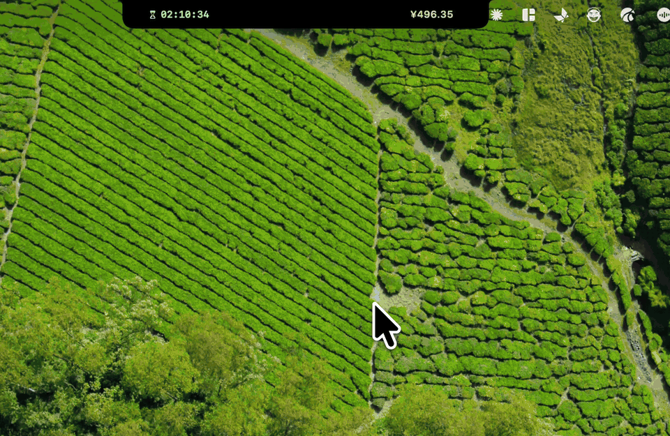
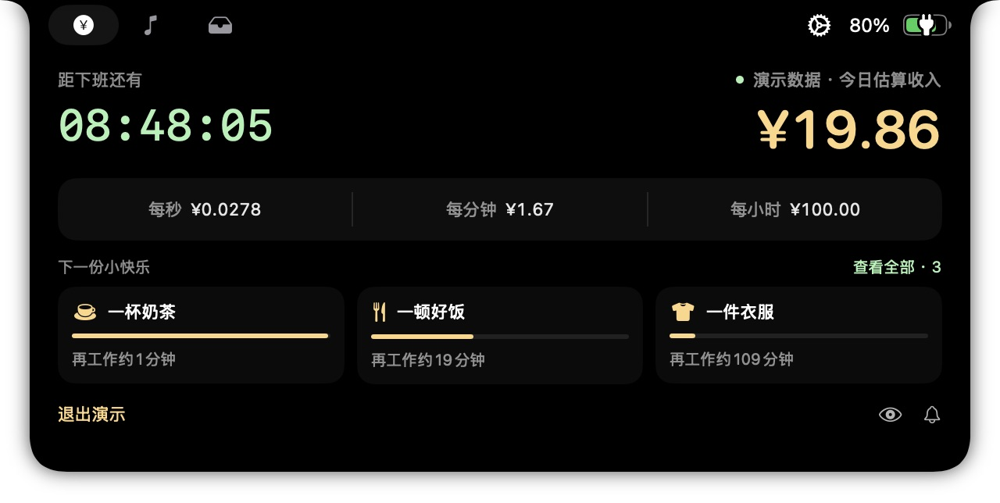
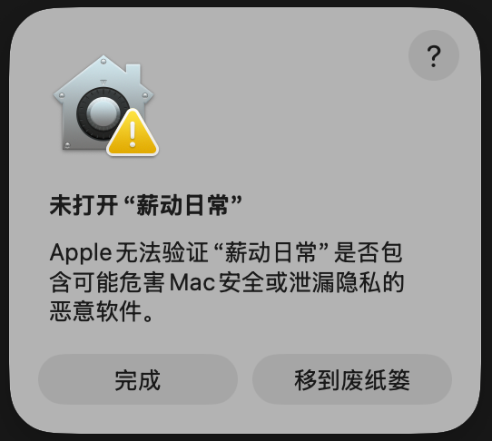
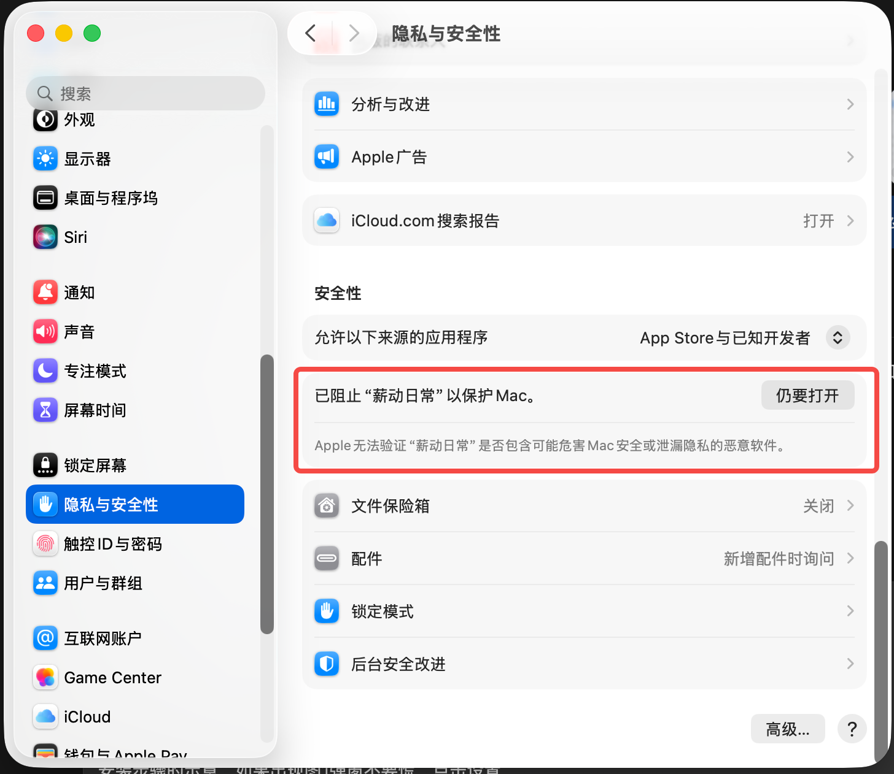
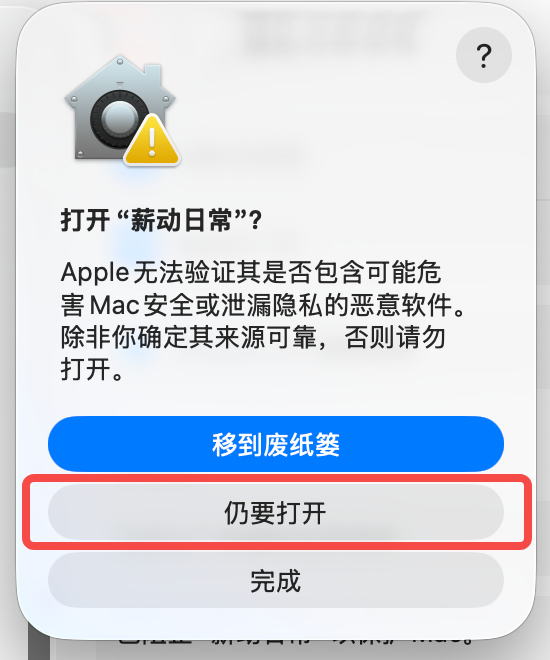

# 薪动日常

**下班倒计时在走，奶茶钱也在到账。**

一款陪你上班的 macOS 灵动岛小工具。把月薪换算成每秒、每分钟、每小时的收入，看着时间变成奶茶、好饭和一件喜欢的衣服。

[下载 v0.1.4 体验版](https://github.com/wekobear/salary-island/releases/tag/v0.1.4) · [安装图解](docs/INSTALL.md) · [使用与构建说明](README-SalaryIsland.md)

## 21 秒，看时间变成生活的一点甜

*演示录制于较早版本；v0.1.4 已移除顶部文件入口与电量显示。*

**抬头看下班，顺便看今天赚到了多少快乐。** 灵动岛常驻显示倒计时和今日估算收入，展开即可查看秒薪、分钟工资与时薪。把奶茶、好饭、一件衣服设成每日小目标，达成时收下一句鼓励。

查看主界面截图

*此静态截图使用内置虚构演示数据。*

## 它会陪你做什么

- **等下班**：紧凑和展开状态都把倒计时放在左边，收入放在右边。
- **看工资增长**：展示今日估算收入，以及每秒、每分钟、每小时的收入速率。
- **领一点快乐**：自定义最多 5 项每日目标，用细进度条看下一杯奶茶还有多远。达成时给一句短反馈，倒计时和金额保持可见。
- **选择陪伴方式**：温柔、抽象、嘴替三种语气；眼睛隐藏收入和目标，铃铛让提示安静到下班，点击都有状态提示。
- **按自己的作息来**：支持工作日、上下班、午休、临时休息和补班；保存前预览日薪、时薪与生效时间。

## 开始使用

1. 在 [Releases](https://github.com/wekobear/salary-island/releases/tag/v0.1.4) 下载 `SalaryDaily-v0.1.4-macOS.zip`，解压后将「薪动日常.app」拖入「应用程序」，双击打开。
2. 点击「播放奶茶演示」先看效果，或填写月薪与作息，预览后保存。
3. 把鼠标移到屏幕顶部灵动岛，查看倒计时、今日收入和下一份小快乐。
4. 点击顶部齿轮打开设置，左下角可「退出薪动日常」；关闭设置窗口只会收起设置。

### 首次打开遇到弹窗？按这 3 步操作

从本仓库下载并确认来源可靠后：点击「完成」→ 打开「系统设置 → 隐私与安全性」→ 在「安全性」区域点击「仍要打开」→ 在确认弹窗中再次点击「仍要打开」。

[查看完整安装图解](docs/INSTALL.md)

展开查看 3 张操作截图

**第 1 步：首次弹窗点击「完成」。**

**第 2 步：系统设置 → 隐私与安全性 → 仍要打开。**

**第 3 步：在确认弹窗中再次点击「仍要打开」，按系统提示完成身份验证。**

当前体验包适用于 **Apple Silicon、macOS 14+**，已在 macOS 26 内置刘海屏验证。升级沿用原配置，无需重新填写月薪。

收入是按计划作息折算的**估算值**，不连接银行；目标独立比较，不扣除收入，也不代表已经消费。薪酬数据保存在本机，无需账号。首版支持同一天内的班次，节假日与调休需手动设置。

## 版本与开发

v0.1.4 移除暂不可用的文件架、隔空投送和拖放入口，并去掉电量显示与相关设置。保留下班倒计时、收入估算、快乐目标、音乐和心动钱包图标。

[更新说明](docs/RELEASE-v0.1.4.md) · [测试与已知限制](docs/TEST-SECURITY-v0.1.md) · [产品文档](docs/PRD-v0.3.md)

## 许可证

[GPL-3.0](LICENSE) · [开源许可与声明](THIRD-PARTY-NOTICES.md)
