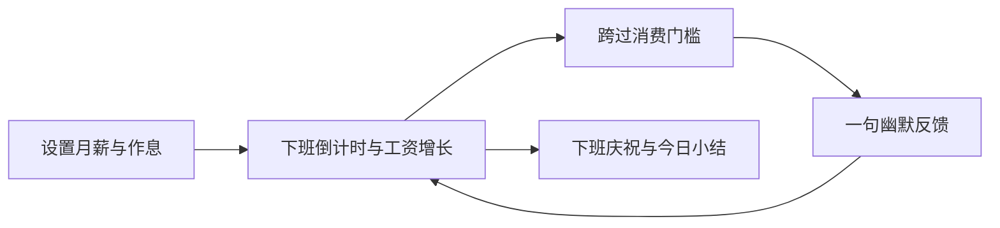

# 薪动日常｜产品需求文档 v0.3

当前权威稿：[Notion 私人草稿](https://app.notion.com/p/3fe784e7e17e81b294c3e8e23a870b47)。本文件为需求v0.3及v0.1.1修订的本地交付快照（2026-10-20），Notion仍为权威当前稿。

版本：v0.3 审核修订稿。独立审核：AGY Claude Opus 5.5 High 已返回完整意见，Codex 已逐条复核并完成本轮修订。日期：2026-10-19。产品名「薪动日常」（2026-10-20用户确定，原名「薪动岛」）。技术基础：Boring Notch 的 macOS 原生应用。本文是产品定义，不代表功能已经实现。Notion 私人草稿为后续维护的当前稿，本地文件为同版本交付快照。
## 1. 产品决定
让用户在等待下班时，看见时间正在变成可感知的小快乐。核心体验是「下班还剩多久 → 今天估算赚了多少 → 已经够买什么」，幽默对象是打工处境和不合理待遇，不是用户的能力或收入。
核心用户：按固定月薪、固定日班工作的 Mac 用户。主场景为办公时瞄一眼顶部灵动岛，查看下班时间和工资增长，偶尔收到一句有趣反馈。
一句话介绍：**把上班的每一秒，换算成生活里的一点甜。**

| 用户给我们的注意力 | 产品应该给什么 | 示例 |
|---|---|---|
| 瞄一眼 | 时间在减少，钱在增加 | 距下班 01:23:45 · 今日 ¥376.28 |
| 悬停两秒 | 看得懂的收益与下一份期待 | 每小时 ¥100 · 再工作12分钟，一杯奶茶 |
| 偶尔四秒 | 一个让人会心一笑的瞬间 | 奶茶钱到手。今天先替珍珠打工到这里。 |

“情绪价值拉满”指反馈贴切、及时、有变化，不指声音最大、动画最多或不断打断。一天结束要给用户一个完成感：本日累计、已覆盖的单项消费、下班祝福，点击即可收起。
采用 Boring Notch 改造，保留它的窗口、悬停展开、设置、显示器选择及既有功能入口。薪酬是默认主页；音乐、日历等作为可选模块保留，不额外扩展这些模块。仅使用薪酬功能不申请摄像头、日历等无关权限。
首版不做银行入账、考勤核验、个税计算、真实消费或理财建议；「到账」是表现文案，数据标签统一为「今日估算收入」。不把应用运行时长当成工作时长。
## 2. 版本范围

| 阶段 | 范围 | 完成标准 |
|---|---|---|
| V1 核心 | 下班倒计时；每秒/分钟/小时收入；今日累计；奶茶/餐食/衣服里程碑；本地幽默文案；可选自填参考薪资对比；设置及隐私模式 | 输入月薪和作息后，当天完整循环可用，重启与休眠后金额正确、反馈不重复 |
| V1.1 数据与目标 | 有来源的平均/中位薪资数据；跨日愿望目标；发薪日倒计时 | 对比口径清楚，长期目标不与每日累计混算 |
| V2 富豪对比 | 基于有来源的财富变化数据做每秒换算和幽默解释 | 明确比较的是财富变化，不是工资或实时现金到账 |

低于参考薪资的幽默反馈纳入 V1，但参考值由用户自填并明确标注；有来源的城市/行业平均工资库放到 V1.1，不编造默认平均工资。
## 3. 首次使用与日常路径

首次打开：演示模式预览灵动岛 → 输入月薪及税前/税后标签 → 选择工作日与上下班、午休 → 显示估算日薪和时薪供校对 → 开始使用。可跳过演示，演示始终有「演示数据」标签且不写入真实成就。
默认作息模板为周一至周五、09:00–18:00、12:00–13:00 不计薪午休；只是可编辑模板，不推断用户的真实作息。币种首版 CNY。月薪要求用户输入，不能默认拿示例金额进入正式模式。月薪需为有限正数、最多两位小数并能精确转换为整数分；工作日至少选一天；下班须晚于上班；午休须位于班次内且小于班次长度；无效时给字段旁具体修正提示。
日常路径：上班前显示距上班 → 工作中倒计时和累计增长 → 跨过消费门槛时短提示 → 悬停查看明细 → 下班时一次庆祝 → 下班后显示今日小结。开机启动由用户设置，不偷偷开启。
## 4. 计算口径：先算准，再搞笑
### 4.1 参数及公式
月薪 M：用户填写固定月薪，标为税前或税后；不自动推算扣税、奖金、佣金、加班费。工作时区默认系统当前时区并保存；旅行时不自动改变作息时区。
月度工作计划：按用户选中的每周工作日生成当月排班，可手动将某日改为休息或补班。首版不接节假日服务，明确提示「未自动包含法定节假日与调休」。一个工作日仅支持同一天内的一段班次和至多一段午休；夜班/跨午夜班次 V1 不支持，输入时直接说明。
- 月计划计薪秒数 T = 当月所有计划班次的计薪秒数总和。
- 秒收入 r = M / T；分钟收入 = 60r；小时收入 = 3600r。
- 今日估算收入 E(t) = r × 今日已过去的计划计薪秒数，限制在 0 至今日计划日薪内。
- 下班倒计时 = max(0, 当天班次结束时刻 − 当前时刻)。午休期间倒计时照常减少，收入是否增长取决于「午休计薪」设置，默认不计薪。
- 用户看到的每秒/分钟/小时金额是收入速率；累计金额是今日估算所得。界面区分两者，不每分钟、每小时弹一次通知。
- 界面可见时每秒最多重绘一次，锁屏及完全隐藏时停止UI刷新；恢复立即校正。可见值根据时间重新计算，不用「每秒加一笔」累加。金额用总月薪×已计薪秒数÷月计划秒数计算，避免先舍入秒收入再累加；成就门槛按未显示舍入的金额比较，显示金额采用四舍五入到分；速率显示每秒最多四位小数，小于显示精度时用「<¥0.0001/秒」。
在整月月薪、作息与排班均未变更且按完整计划计薪时，该方案保证整月未舍入估算累计等于 M（逐日显示舍入后相加可能有分位误差）；不同月份计划工时不同，时薪可能变化，这是月薪折算的结果。休息日收入为 0，不是对工资权益作判断。非计划加班不自动增加金额，到点后文案鼓励下班。
算例：M=¥17,600，当月22个工作日，每天8个计薪小时：时薪¥100、分钟¥1.6667、秒¥0.0278；09:00开始，10:00累计¥100；12:30累计¥300；13:30累计¥350；18:00封顶¥800。全天倒计时起点9小时，不是8个计薪小时。
### 4.2 重启与变更
睡眠、锁屏、退出不暂停计薪时间；恢复时按作息与当前时刻重算。用户选择「安静」只关闭自动反馈，不影响计算。
同一工作时区内，月薪、作息及休息/补班例外保存后立即生效，按新方案重算今日整个计薪时段，包含保存前已过去的计薪时间。收入、日薪、时薪、倒计时与休息状态同步更新，无需再使用「修正今日」。当日重复修改覆盖当日方案及尚未生效的旧计划，不改变历史日期记录。工作日规则至少保留一天，当月总计薪秒数必须大于0；无效修改不保存。
新版本的 T 按该月过去日期排班，加上今日及未来的新排班合计。今日快照更新 M、T 与计薪区间，历史快照保持原样；月中变更后本月合计可能不等于某个月薪。预览明确显示「保存后立即生效 · 重算今日」、全天预计收入和时薪。保存时保留今日已有达成记录与展示次数，清除旧待播，新跨过门槛静默记录，避免改月薪刷奖励。保存失败不发布新金额。
填错薪资时可单独选择「修正今日估算」，预览并确认后仅替换今日金额计算快照，历史日期不变；不顺带改变未来配置，未来变更仍按上述规则保存。修正不补播门槛，当前已达门槛静默补记，已展示/已达成记录保留，并清除今日尚未展示的旧待播事件。下一自然日按已保存的工作时区切换今日记录，非工作日显示休息状态。
系统时间变化时按当前时间重新计算，必要时收入显示可回退；不冻结功能、不要求用户做校时操作。已触发的同日里程碑不再播放，避免来回调时间刷奖励。时区变更在旧时区中今天之后首个计划工作日的上班时刻生效，保存绝对时间点，预览显示目标时区的具体时刻。当前版本、日期与账本统一解析，日记录以工作时区和当地日期联合标识；旧记录原样保留，兼容迁移旧日期键。切换当天仅计算生效时刻之后的新时区计薪区间，不补算已经过去的小时；若新时区班次已结束，当日收入为0。月计划T使用同一裁剪后的区间，历史已保存快照不重算。
## 5. 灵动岛展示与反馈优先级

| 状态 | 紧凑态主内容 | 展开内容 / 行为 |
|---|---|---|
| 工作中 | 左：距下班 02:14:38；右：¥238.46 | 今日累计、时/分/秒速率切换、下个里程碑和所需工作时间 |
| 午休 | 「补给中」+ 距下班 | 说明午休是否计薪；金额依规则暂停或增长 |
| 里程碑 | 短时展开图标与一句话 | 4秒后恢复此前状态；悬停时保持，离开后收起 |
| 下班 | 「今日已下班」 | 今日估算总额 + 达成物品；到点且未被屏蔽时一次庆祝；重新打开时只显示小结 |
| 休息日 | 「今日不营业」 | 下个工作日信息，不显示负倒计时 |
| 隐私模式 | 只显示下班倒计时 | 金额、薪资参考及可推断消费门槛的名称/进度全部遮盖；不自动展开任何薪酬提示 |

紧凑态宽度不足时优先保留下班时间，金额采用缩写并在展开态显示完整值。物理刘海中心不可放文字；无刘海及外接屏用顶部模拟刘海，采用原项目显示器设置并实机验收。
沿用 Boring Notch 的单一窗口与展开模型。主动操作（悬停查看、拖文件、原模块交互）优先于自动提示；下班庆祝优先于普通里程碑；原系统 HUD 与薪酬提示排队显示，不叠层抢位。主动操作结束后再展示仍相关的最新提示。
数字使用等宽数字（Tabular nums），宽度稳定；不要每秒播放整块跳动动画。短反馈使用轻微 spring 或 ease-out，约180–250ms；尊重系统 Reduced motion，改用淡入淡出。沿用原设置的键盘入口，并给核心信息提供 VoiceOver 标签；不逐秒向屏幕阅读器播报。
## 6. 消费里程碑：把抽象金额变成小快乐
默认独立里程碑：¥20 奶茶、¥50 一顿饭、¥200 一件衣服。价格只是可编辑示例，不是市场平均价。用户可改名称/金额、关闭某项，或创建最多5项每日里程碑。可关闭全部消费目标，不强制保留；不因收入高低自动改价。目标金额须为正数且最多两位小数。门槛按金额升序排列，不扣减累计收入，也不表示真的购买过商品。
工作中跨过门槛记录达成一次，持久化去重键为班次ID+里程碑ID（同一工作日仅一班）；达成与展示分开保存，被静音/过期/频控跳过的达成不丢失。实际弹出受调度规则约束。门槛判断使用整数比较：月薪分×已计薪整秒 ≥ 门槛分×T，不经过浮点除法；实现须检查输入与乘积范围，使用不会溢出的精确运算，不能依靠容差提前触发。展示金额仍按公式舍入到分。
当天修改门槛：新金额不超过当前累计且该ID未达成时，静默标记达成；已达成的不因调高门槛撤销，历史达成保存当时名称和价格，今天不以新价格再播。修改或删除目标时清除其旧待播事件。删除后重建是新ID，若已被当前收入覆盖则同样静默标记。每个新工作日重新开始；首次安装按当天作息计算已有收入，之前已覆盖的门槛仅静默记录。
不把「奶茶+饭+衣服」相加成可消费余额；展示「今日估算收入已覆盖这些单项价格」。超过当天可赚金额的目标显示「约需N个相同班次」：N=目标价格÷当前计划日薪向上取整；日薪为0时显示「设置有效月薪后估算」。这是所需工时换算，不是跨日累计进度；V1.1 才支持跨日存目标。
为了不让低薪或较晚安装的用户整天没有反馈，首日正式配置完成页给一次「你的工资开始按秒营业了」的内联欢迎，不自动弹岛、不占普通提示额度，也不伪装成收入成就；之后若开启了消费目标但当日没有可达门槛，使用计薪时间进度50%（已计薪秒÷今日计划计薪秒）的一次非消费鼓励「半场结束，离下班又近了一截」。首次配置时已过50%则只在设置完成页显示当前进度，不补弹历史鼓励；关闭全部目标时同时关闭这一兜底鼓励。它计入普通提示上限，不能把“进度过半”说成“奶茶已到手”。
自动普通提示（消费门槛、进度鼓励、下班前5分钟文案）共用20分钟间隔与每日最多5次额度，按实际展示记数；其中1次预留给下班前5分钟提醒，消费门槛与进度鼓励合计最多4次。首个提示无需等待20分钟，预留额度不豁免间隔或屏蔽规则，因此提醒不保证恰在下班前5分钟弹出。用户主动预览不记额度、不产生真实成就。
只有一个普通待播位：下班前5分钟 > 消费门槛（取当前最高金额）> 进度鼓励；同优先级保留最新事件。门槛与进度鼓励以实际跨越时刻起30分钟过期；下班前5分钟提醒在班次结束时过期。休眠恢复时补记全部达成，最多保留尚未过期的最高优先级事件，不能把恢复时间当成达成时间重新计时。班次结束时清除所有普通待播事件，达成内容并入静态小结，避免下班后继续弹工作奖励。
下班庆祝每天最多1次，不占普通额度；仅在应用运行且观察到班次结束、未被屏蔽时触发，延迟等待用户操作结束最多30秒，过期只保留小结。休眠或退出跨过下班时间不补播。主动操作及原HUD优先级仍按第5节执行。
全屏/锁屏/隐私模式/用户安静模式下不自动展开任何薪酬提示，包括不带金额的下班提醒。隐私模式还遮盖展开态、小结中的金额、消费物品名称及进度，金额用「¥•••」，只保留时间信息；退出隐私或安静模式后，被屏蔽的反馈仅静态可看，不补弹。达成继续记录。系统专注状态仅在平台支持且用户主动授权后读取，状态为未知不能当成已关闭。未授权或不可读时提供「安静到下班」，不宣称已自动跟随系统专注模式。声音默认关闭。
文案示例：

| 事件 | 默认抽象档 | 温柔档 |
|---|---|---|
| ¥20 | 奶茶钱到手。今天先替珍珠打工到这里。 | 一杯喜欢的奶茶，已经赚到了。 |
| ¥50 | 午饭已被本场打工赞助。 | 今天的午饭，安排好了。 |
| ¥200 | 衣服到手。工位坐着，衣柜更新着。 | 又靠近一件喜欢的衣服。 |
| 下班前5分钟 | 灵魂已到地铁口，肉身还剩5分钟。 | 还有5分钟，今天辛苦了。 |
| 下班 | 今日份窝囊费估算完毕，建议本人离场。 | 今天到这里，生活时间开始。 |
| 休息日 | 今日暂停出售灵魂。 | 好好休息也是正事。 |

文案库本地运行，首版无AI调用、无账号；默认抽象档，可切换温柔/抽象/嘴替。嘴替只吐槽处境，不使用“你不值钱”“废物”等针对用户的贬低，不用收入制造羞耻。相同文案7天内尽量不重复，候选不足时允许重复，不无限生成。
## 7. 参考薪资与富豪对比
### 7.1 V1 薪资参考与 V1.1 统计基准
独立开关，默认关闭，主要在用户主动打开「薪资对比」时呈现。先支持自填参考月薪，须同时选择税前/税后，币种为CNY，金额为有限正数、最多两位小数。明确标为「你设置的参考值」，不可命名为城市平均工资。与用户月薪税前后口径不同或未知时仅并列列出原值，不计算差额和高低结论。
如果以后内置统计数据，必须记录地区、行业/人群、统计年份、均值或中位数、税前/税后、币种及原始来源；与用户口径不兼容时仅展示参考资料，不输出高低结论。年薪与月薪需显式换算，奖金是否包含必须说明。不先编一个全国平均数。
当参考月薪B与M口径可比时，显示差额M−B和相对差额(M−B)/B。绝对相对差额小于10%时采用中性文案「与参考相差不到10%」，仍保留精确差额；这是产品语气阈值，不是统计上的基本持平。低于参考至少10%时才使用找机会的幽默，不据此断定用户应辞职。默认抽象档：「这份报价，值得再找几家问问。」嘴替档可用：「可以看看新工作了，先更新简历，别急着更新离职状态。」高于参考至少10%时：「这份报价，比你设的参考更亮眼。」不能因收入低而减少奖励或提高成就门槛。
调侃只在用户主动展开薪资对比卡片时显示，不自动弹岛、不进入普通提示队列；同一参考版本每周至多展示一次调侃，其余时间显示中性差额，可一键关闭。隐私模式隐藏卡片内容。不投放招聘广告、不自动跳招聘网站。数据过期或无可比口径时不显示高低结论。
### 7.2 V2 富豪每秒对比
默认选取相同起止时刻的自然时间区间，展示「你的估算工资¥A」与「对方估算净资产变化±¥B」，再分别除以该区间自然秒数做速率展示。A按该区间实际计薪段与对应薪资快照求和；没有该区间的薪资快照时不生成对比，不能把当前月薪冒充历史所得。计薪秒速率只留在用户收入详情，不与财富的自然秒速率直接计算倍数。相同时间尺度仍不代表工资与资产变化是同一种收入，分栏持续标注估算口径。
记录人物、起止日期、资产估值来源、币种和汇率日期；净资产变化可以为负。不能把财富存量除以秒数叫“每秒到账”，也不能把一段上涨期当作永久收入速率。暂不指定某位富豪和未经核验的数值。
幽默落点：「他那边是估值涨跌，你这边是奶茶进度。今天先把自己的快乐领了。」财富变化为负时：「他那边估值回撤了，你这边奶茶进度照常。」用户主动打开，随时退出；不上排行榜、不做低收入羞辱。
## 8. 实现边界与数据
沿用 Swift/SwiftUI/AppKit、Boring Notch 主窗口/设置/显示器模块。新增独立薪酬计算模块、日程快照、本地里程碑和文案模块、提示调度器，再接入原展示状态；不把算法塞进视图，也不同时另接第二套灵动岛窗口库。
本地数据：SalaryProfile（M、税前后、币种、时区、作息、生效日）；WorkCalendar（月度排班和例外）；DailySnapshot（稳定班次ID、日期、时区、M、T、计薪区间、版本号）；Milestone（ID、名称、金额）；TriggeredEvent（班次ID、事件ID、跨越时刻、达成时名称和价格、展示/跳过状态）；UserPreferences（语气、声音、隐私、安静、原功能开关）。薪酬模块不采集窗口标题、键鼠操作或真实考勤；不向上游上传薪资。原可选模块沿用其既有权限与行为，不能未经审计就替整款上游应用承诺零网络或零窗口读取。薪资和配置不写入普通日志，错误日志脱敏。提供清除薪酬数据入口，具体列出将删除的配置/日记录/成就，不连带删除原模块数据。
上游基线来自当前已审核 main commit 前缀23e7705a4f；正式开工时记录完整SHA及必要依赖。保留 GPL-3.0 与原作者声明，使用独立应用名称、bundle ID、数据目录和更新源，避免覆盖原 Boring Notch 或被上游升级替换。发布签名和分发另行处理，本轮不执行。
## 9. 验收用例

| 编号 | 条件 / 操作 | 预期 |
|---|---|---|
| A01 | 示例月薪17600、22日×8h | ¥100/h；10:00累计100；12:30为300；13:30为350；18:00为800 |
| A02 | 午休不计薪12:00–13:00 | 收入不变，下班倒计时继续减少 |
| A03 | 睡眠一小时后恢复 / 同日重启 | 按当前时刻恢复正确累计，不从0起步、不重复触发旧成就 |
| A04 | 18:00后仍开机 | 金额封顶800，倒计时0，不自动创造加班收入 |
| A05 | 从09:00连续运行、09:12跨20元、重复打开 | 当日奶茶达成仅记录一次；没有其他提示阻塞时弹出一次 |
| A06 | 一次恢复跨20/50/200 | 静态记录三项；最多合并展示最高一项，过期不补播 |
| A07 | 开班前/开班后修改月薪、作息或排班例外 | 同一时区保存后立即重算今日及速率，预览与结果一致；历史金额不回溯，奖励不补播 |
| A08 | 休息日/补班日/月末切月 | 对应排班计算；当月T>0，否则给出可修复错误，不除0 |
| A09 | 隐私/全屏/安静/拖文件 | 隐私下不自动展开任何薪酬提示，手动展开也遮盖金额与物品进度；计算继续；主动操作不被打断 |
| A10 | 参考口径不一致/无来源 | 不输出“低于平均工资”结论 |
| A11 | 富豪资产区间为负 | 显示财富减少，不能变成正的工资或实时到账 |
| A12 | 当日预计收入低于所有消费门槛 | 当日工作进度50%时可收到一次非消费鼓励；不冒称奶茶已赚到 |
| A13 | 秒收入为循环小数、门槛恰好20元 | 整数交叉乘法判断；示例09:12:00触发，不等到09:12:01；超出安全乘积范围明确拒绝或使用精确大整数 |
| A14 | 系统专注状态不可读 | 不显示“已跟随专注”；手动安静后自动提示停止，金额继续计算 |
| A15 | 今日估算已超20元，新增/改低为20元，再调高或删除重建 | 静默记达成，已达不撤销，不补播；变更清除旧待播 |
| A16 | 4次门槛已播，17:55产生提醒；或17:50刚播门槛 | 前者有预留额度且满足间隔才可播；后者不破20分钟间隔，到18:00清空待播，不在下班后播 |
| A17 | 显式修正今日估算，金额上升/下降 | 仅今日重算，不修改过去/未来；新达成静默补记、旧达成不撤销、旧待播清除 |
| A18 | 自填参考税前后不同；同口径差距1%、10% | 不同不下结论；1%仅中性差额；10%允许对应调侃，只在主动打开的卡片内显示 |
| A19 | 全部目标关闭；首次配置已过50%；恢复时跨门槛已过30分钟 | 不触发兜底鼓励；配置页显示进度；过期门槛静态记达成、不补弹 |
| A20 | 已完成10个8h工作日，当月原22日，开班前新增1个未来补班；M=17600 | 历史10日仍各800；新T=23×8×3600，新完整日收入未舍入值为17600/23；当月合计不强行等于17600 |

开发阶段另验证：数字刷新不造成布局抖动；无刘海/外接屏/全屏/空间切换；VoiceOver；减少动态效果；开启与关闭薪酬模块的CPU/能耗对比。性能结果实测后记录，不在PRD里冒称已达标。
## 10. 首轮验证
邀请5–8名自愿试用者体验5个工作日，产品成功先看：能否在2分钟内完成设置；能否正确理解“估算收入”；反馈是否让人开心且不过度打断；是否自愿在第5天继续开启。建议目标：≥80%独立完成设置，≥80%理解计算口径，≥70%愿意保留。只是小样本决策门槛，不是增长成效。
不默认上传工资或安装分析SDK；通过自愿访谈和匿名手工反馈收集结果。若用户普遍觉得烦，优先减频率、缩短文案，不增加奖励弹窗。
## 11. 依据
- [Boring Notch 源码与README](https://github.com/TheBoredTeam/boring.notch)
- [BoringViewModel](https://github.com/TheBoredTeam/boring.notch/blob/main/boringNotch/models/BoringViewModel.swift)：现有展开状态、显示器及全屏检测衔接。
- [GPL-3.0](https://github.com/TheBoredTeam/boring.notch/blob/main/LICENSE)
- 本次开源选型审核及本地设计词典：等宽数字、悬停态、ease-out、spring、Reduced motion、情境语气、数字格式。
- [Apple 专注状态授权接口](https://developer.apple.com/documentation/Intents/INFocusStatusCenter)：存在状态访问与授权边界，具体应用适用性在开发时验证。
## 12. Claude 独立审核与采纳记录
2026-10-19 经 AGY CLI 显式调用 claude-opus-5-5-high，以 Notion v0.2 完整正文为输入。本次返回非空审核正文，status=SUCCESS、num_turns=1，耗时约97秒；之前资格检查/空返回的失败已不再作为当前阻塞。以下是 Codex 对意见的复核与落实，未将“收到审核”表述为产品已实现或所有检查通过。

| Claude 的问题 | 主审决定与落实 |
|---|---|
| 1. 月中变更、排班例外与生效时间不统一 | 采纳统一快照和开班前/后规则，明确T的过去/未来排班组成。部分采纳：不新增月度预测面板，现有预览给出具体生效日、日薪、时薪与月合计可能不等于月薪的说明（§4.2、A07/A17/A20）。 |
| 2. 隐私模式范围冲突，物品门槛可推算收入 | 采纳遮盖物品名称和进度；不采纳允许无金额提醒自动展开的建议。统一保持隐私模式全部薪酬提示不自动展开，避免两套规则（§5/§6、A09）。 |
| 3. 提示额度、优先级与下班后待播不明确 | 采纳提醒预留额度、待播排序及到点清空；仍遵守20分钟间隔，不承诺17:55必弹。补充下班庆祝过期规则（§6、A16）。 |
| 4. 浮点门槛误差和编辑规则不严谨 | 采纳整数交叉乘法、输入与溢出检查、静默补记、调高不撤销及删除重建规则；同步清除变更前待播（§3/§6/§8、A13/A15）。 |
| 5. 参考薪资口径、调侃位置与富豪比较不完整 | 采纳税前后标签和卡片内呈现。10%仅作语气阈值，改为“与参考相差不到10%”，不宣称统计持平。V2默认同一自然时间区间，补充负资产变化文案与历史薪资缺失处理（§7、A18）。 |

Claude 建议保留且本稿继续保留：按计划时间实时重算与日薪封顶；达成与展示分开记录；以 Boring Notch 为载体的抽象语气和不羞辱用户的情绪定位。
Codex 另修订：允许全部关闭消费目标；明确50%按计薪时间计算，晚安装不补弹；“修正今日”与默认生效规则分开验收。验收由14项扩展为20项，其中A11属于V2，其余按对应版本验证。
文档核验（2026-10-19）：公式与整数门槛示例复算、条款冲突检查、采纳项映射及 Notion 写后读回。当时尚未开发应用；2026-10-20 的实际开发与验证见下节。

## 13. v0.1.0 本地体验版交付 · 2026-10-20
已基于 Boring Notch 完整 SHA `23e7705a4ffcb5d97a54fb1d4135e180084a566d` 开发，分支 `feature/salary-island-v1`，该阶段未推送；其后已按用户要求推送私有仓库 https://github.com/wekobear/salary-island 并提供 v0.1.0 预发布包，未合并主分支。交付 macOS 应用、对应 GPL 源码、体验说明、测试与安全检查、运营推广初稿；本节是实施记录，需求版本仍为 v0.3。
已实现：灵动岛默认薪酬页、下班倒计时、秒/分/时工资、当日估算、最多5项消费门槛、三种本地语气、隐私与手动安静、自填参考薪资、排班例外和生效预览、今日修正、日快照与达成去重。原音乐和原设置保留入口，音乐按主动访问初始化。内置“播放奶茶演示”使用明确标记的虚构数据。
当前首版不支持跨午夜班次；节假日需手动设置。系统专注状态尚未自动读取；富豪对比、统计平均工资库、跨日存目标和发薪日按后续版本处理。

## 14. 测试与安全检查摘要
纯计算与提示调度51项自动检查通过：22工作日示例、午休和封顶、精确门槛、排班版本与月中分母、事件去重/合并/过期、20分钟间隔与预留额度、静音隐私、低收入进度和时钟回拨。模拟恢复测试不等于真实整机睡眠测试。
Xcode 26.6 / Swift 6.3.3 构建成功；当前 Apple Silicon、macOS 26、内置刘海屏实际看到金额增长和奶茶反馈，核验了隐私遮盖、保存及重启恢复。测试工资为虚构17600，交付前移出应用数据目录，首次设置保持为空。
独立 bundle ID 与数据目录，JSON目录0700/文件0600，保留 App Sandbox；薪酬模块未发现网络请求或工资日志。上游可选模块仍可能联网，不承诺整款应用零网络。关闭上游自动更新源，保留 GPL 与作者声明。嵌套 ad-hoc 签名验证通过，尚未做 Developer ID/公证。
尚未完成：无刘海/外接屏切换、真实锁屏睡眠、Spaces/全屏组合、完整VoiceOver、Reduced Motion实机表现、CPU/能耗对比、跨时区和日期回拨组合、macOS 14/15兼容。以上不计作已通过。
开发曾按 wekowork 尝试 GLM 5.3；探针成功但正式实现任务无可用输出，终止后由 Codex 完成代码与核验。此前 Claude 5.5 审核覆盖 PRD；之后 Gemini 4 UI、Claude 5.5 代码审核及本轮修复见第16、17节。

## 15. 运营推广初稿（未执行）
定位：“下班倒计时在走，奶茶钱也在到账。”界面继续标注估算收入。首支演示可用20秒展示虚构工资设置、金额增长、奶茶达成、隐私和下班倒计时；不录用户真实工资。
按第10节先做5–8人、5个工作日自愿试用，通过匿名手工反馈了解设置耗时、估算理解、文案感受、打扰程度和继续使用意愿。尚未招募、投放或得到留存数据；先调文案和频率，再决定公开发布。

## 16. 双模型审核采纳

2026-10-20：AGY Gemini 4 `gemini-4-argon-high` 阅读两张界面截图与源码；AGY Claude 5.5 `claude-opus-5-5-high` 审核新增代码、集成、测试与PRD。均返回SUCCESS、1 turn、非空正文；Claude上游上下文部分截断，由Codex补查调用点。原意见及复核报告保留在本地outputs，Notion第16节为同轮摘要。

采纳固定设置底栏、下一目标细进度、完整清单入口、主信息常驻的庆祝横幅；修复未来休息日、跨时区账本、后台设置阻塞、保存失败、日期偏移和改名文案。保留秒薪，驳回隐私金额泄漏和音乐从未初始化等误报。

## 17. v0.1.1 合并修订 · 2026-10-20

产品名改为「薪动日常」；应用、设置及菜单同步，bundle ID与数据路径保持不变，兼容原薪酬配置。展开态左倒计时、右收入，与紧凑态对应。删除底部重复设置，眼睛和铃铛各有2.5秒操作Toast，失败不报成功、不占自动反馈额度。

设置页预览/生效时刻/保存固定底部；上下班与午休区间标签对齐。下一目标优先、3pt进度条、查看全部最多5项；庆祝只替换目标区域，倒计时与金额/速率保持可见。Reduced Motion下内容切换使用透明度过渡。

同区排班按第4.2节保存后立即更新；跨时区使用明确时刻和联合键，不重写旧账本、不补算目的地过去小时。设置失焦/最小化解除busy；保存先原子写入再发布状态，读取失败保留原文件；日期选项按所选年月日保存；改名目标使用通用文案。全屏持续计算但不自动提示；演示与正式成就分离，正式账本静默更新，隐私继续阻止预览。

自动检查：62项核心与22项隔离Store检查通过。构建与本地签名通过。最终原生界面核验和未验证范围见 `TEST-SECURITY-v0.1.md`。v0.1.1为本地体验版，本轮未推送GitHub、未合并主分支。

## 18. v0.1.2 展示与退出入口 · 2026-10-20

菜单、设置、关于及引导统一「薪动日常」名称；产品首页仅展示本项目，开源归属放在独立许可声明。薪酬设置左下角始终提供「退出薪动日常」，支持⌘Q。关闭设置窗口只收起窗口，退出应用才结束常驻。现有月薪、作息及成就不受影响。真实点击退出、进程停止和重开恢复已验证。

## 19. 品牌图标定稿（2026-10-20）

用户从六个钱包跳动方案中选择「03 心动钱包」：薄荷绿钱包、金色爱心扣、两侧跳动线条与深灰圆角底。透明外缘用于 macOS 应用图标；设置、欢迎及关于页复用 SalaryLogo。奶茶里程碑继续使用语义图标。此次为 v0.1.2 build 4 本地更新。

## 20. 暂时移除文件架与隔空投送（2026-10-21）

用户反馈本地修复后仍无法使用，当前版本移除文件标签、文件架和隔空投送页面、相关设置，以及拖文件自动展开和外层拖放接收入口。展开时只显示薪酬或音乐，不再根据旧文件架数据切换页面。既有文件及文件架存储不删除；底层模块暂留源码，未接入运行入口。此项取代此前 build 5 的试验性修复。

## 21. 移除电量展示（2026-10-21）

移除灵动岛顶部电量百分比与图标、电源状态提示和通用设置中的电池页，不再初始化电池监测模型。薪酬与音乐入口保持可用。此变更与第 20 节文件功能移除一起交付本地 build 7。

## 22. 即时更新薪酬（2026-10-21 用户修订）

本节及第 4.2 节取代旧的同区次日生效规则。月薪与作息经预览后保存，立即重算今天；历史记录不变。跨时区仍按明确预览时刻切换。此修订以本地实现与验证报告为准，尚未同步到 Notion 快照。
